<div align="center">

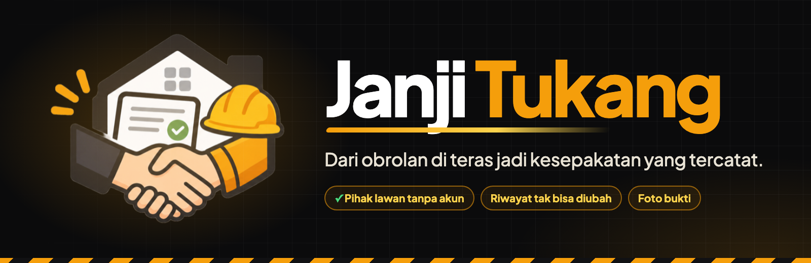

<br>

Catatan kesepakatan kerja renovasi kecil antara pemilik rumah dan tukang atau mandor: lingkup, harga, termin bayar, dan foto bukti pekerjaan. Semuanya tercatat berdua dan tidak bisa diubah diam-diam.


**[Masalah](#masalah)** · **[Tampilan](#tampilan)** · **[Fitur](#fitur-utama)** · **[Alur](#alur)** · **[Menjalankan](#menjalankan)** · **[Arsitektur](#arsitektur-singkat)** · **[Batasan](#batasan)**

</div>

---

## Masalah

Kesepakatan renovasi kecil biasanya lisan. Lingkup, harga, dan jadwal bayar jadi kabur, lalu berubah tanpa catatan. Ujungnya sengketa "dulu bilangnya apa".

Janji Tukang memberi kedua pihak satu catatan bersama. Pihak lawan **tidak perlu daftar akun**: cukup buka tautan dari WhatsApp.

> [!IMPORTANT]
> Ini catatan bersama dua pihak, bukan nasihat hukum. Aplikasi tidak memegang uang.

## Tampilan

Dirancang mobile-first karena pemakainya kebanyakan membuka dari ponsel. Palet diambil dari logo: **arang** `#111113` seperti lengan jaket, **amber** `#F59E0B` seperti helm proyek, **hijau** `#16A34A` seperti centang persetujuan, dan **krem** `#FAF7F2` seperti kertas kesepakatan.

<table>
<tr>
<td align="center" width="25%">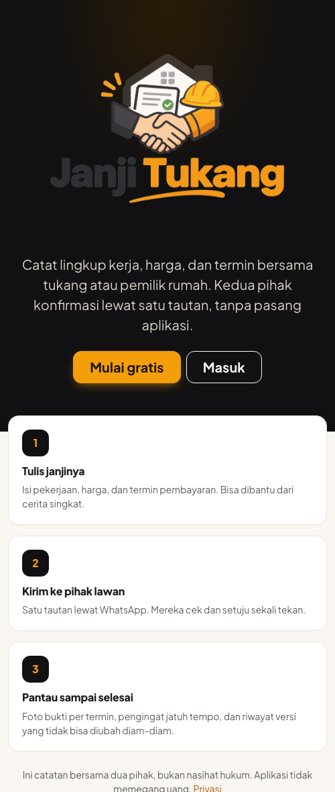<br><sub><b>Landing</b><br>cara kerja dalam tiga langkah</sub></td>
<td align="center" width="25%">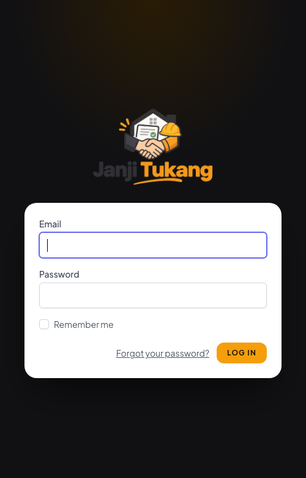<br><sub><b>Masuk</b></sub></td>
<td align="center" width="25%">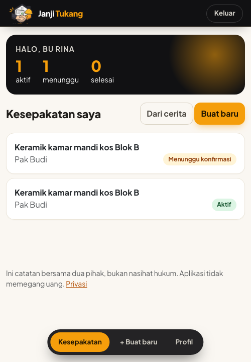<br><sub><b>Beranda</b><br>ringkasan dan status</sub></td>
<td align="center" width="25%">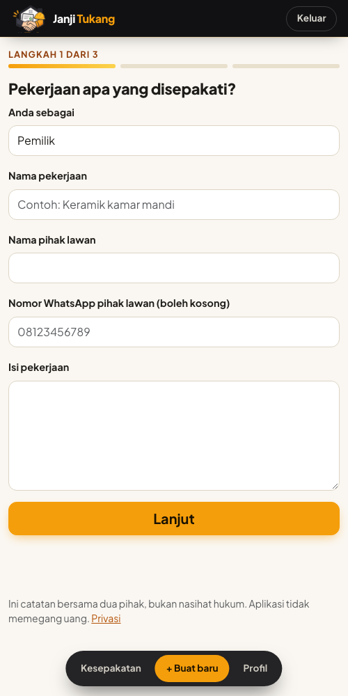<br><sub><b>Wizard 3 langkah</b></sub></td>
</tr>
<tr>
<td align="center">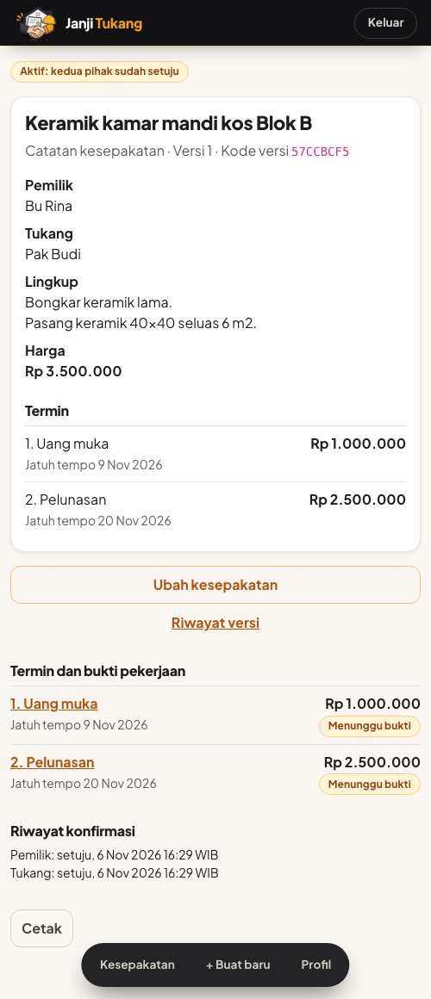<br><sub><b>Kesepakatan aktif</b><br>termin dan bukti</sub></td>
<td align="center">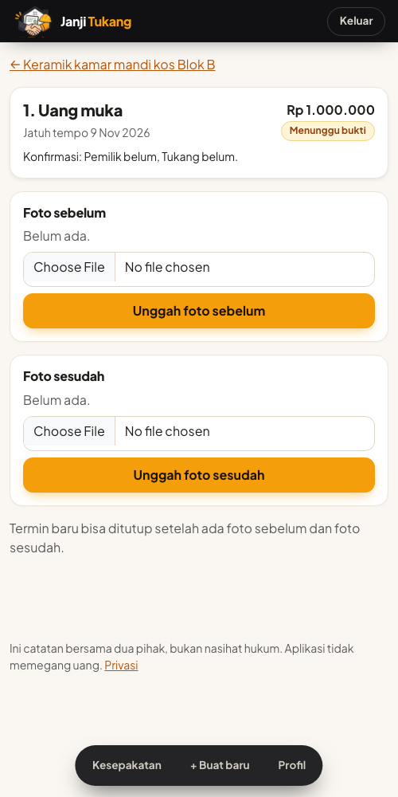<br><sub><b>Foto sebelum dan sesudah</b></sub></td>
<td align="center">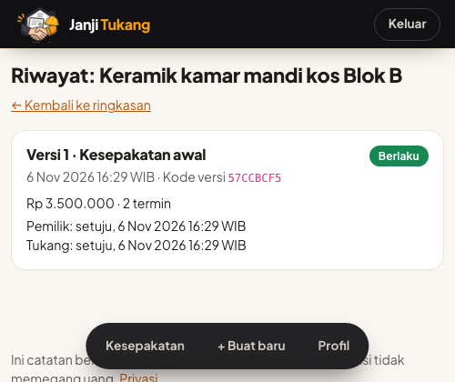<br><sub><b>Riwayat versi</b><br>dan addendum</sub></td>
<td align="center">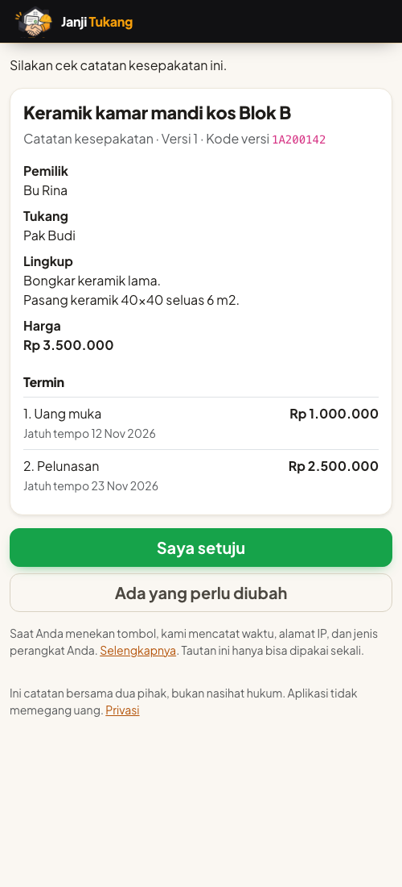<br><sub><b>Pihak lawan</b><br>tanpa akun</sub></td>
</tr>
</table>

## Fitur utama

- **Wizard 3 langkah**: lingkup, harga, termin. Atau tulis cerita bebas, lalu tinjau draf yang dihasilkan (mode `manual` atau `llm`).
- **Persetujuan lewat tautan WhatsApp**: pihak lawan menerima tautan bertanda tangan, tanpa akun, lalu menyetujui atau meminta perubahan. Tautan dipakai sekali dan punya masa berlaku.
- **Versi append-only berantai hash**: versi lama tidak pernah disunting. Setiap perubahan adalah **addendum** (versi baru) yang juga perlu disetujui kedua pihak.
- **Termin dan bukti foto**: tiap termin butuh foto sebelum dan sesudah. Foto dibuat ulang tanpa EXIF (lokasi tidak bocor) dan terkunci setelah konfirmasi pertama.
- **Konfirmasi dua pihak**: termin selesai hanya bila pemilik dan tukang sama-sama konfirmasi. Waktu dan jejak tercatat di server.
- **Pengingat jatuh tempo**: command harian menandai termin yang jatuh tempo, pembuat menekan tombol untuk mengirim pengingat lewat WhatsApp. Tidak ada kirim otomatis.
- **Cetak**: ringkasan kesepakatan dan riwayat konfirmasi bisa dicetak. Navigasi disembunyikan dan animasi dimatikan saat cetak.

## Alur

1. Pembuat (pemilik atau tukang) mengisi wizard, lalu mengajukan **versi 1**. Pembuat otomatis setuju.
2. Pihak lawan membuka tautan dan menyetujui atau meminta perubahan.
3. Bila kedua pihak setuju, kesepakatan **aktif** dan termin hidup dibuat.
4. Tiap termin: foto sebelum + sesudah, lalu konfirmasi kedua pihak, lalu selesai.
5. Perubahan = addendum. Versi berlaku adalah versi tertinggi yang disetujui kedua pihak. Addendum yang ditolak tidak menggeser versi berlaku, jadi kesepakatan tetap aktif.

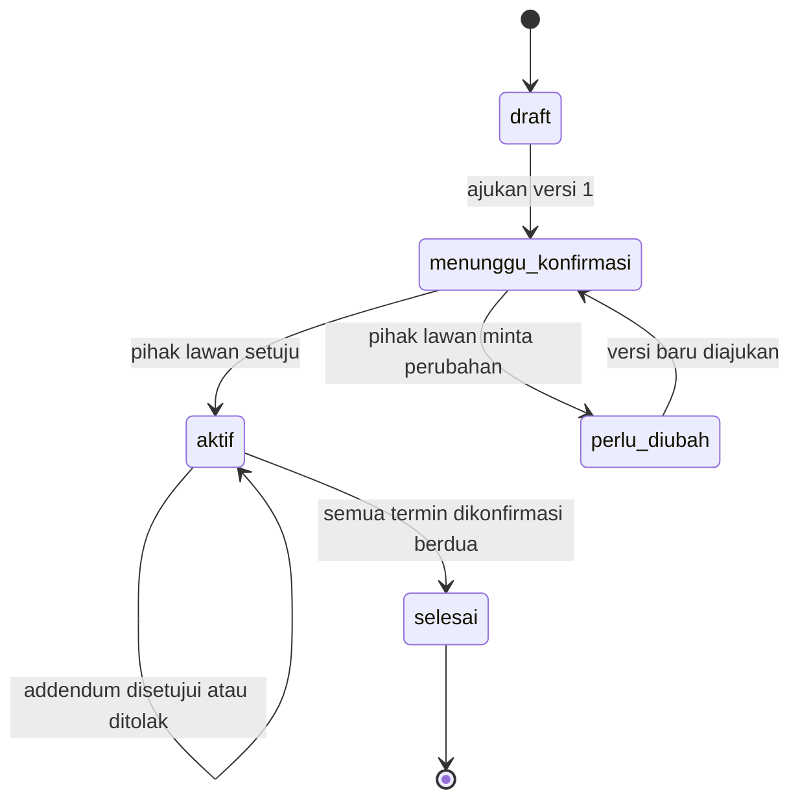

## Menjalankan

Prasyarat: PHP 8.4, Composer, Node.js, dan MySQL.

```bash
composer install
npm install && npm run build               # wajib: halaman login, daftar, dan profil memakai aset Vite
cp .env.example .env && php artisan key:generate
# buat database MySQL `janji_tukang` dan `janji_tukang_test`, lalu atur DB_* di .env
php artisan migrate
php artisan db:seed --class=DemoSeeder     # data contoh (opsional)
php artisan serve
php artisan schedule:work                  # pengingat harian 07:00 (atau: php artisan janji:pengingat)
php artisan queue:work                     # hanya bila memakai driver sms / whatsapp_api
```

Untuk mengembangkan tampilan, jalankan `npm run dev` agar Vite me-refresh otomatis.

Akun contoh dari `DemoSeeder`: `demo@janjitukang.test` / `password`. Seeder juga mencetak tautan konfirmasi pihak lawan. Tautan itu bertanda tangan untuk host tertentu, jadi buka dengan host yang sama dengan `APP_URL` saat seeder dijalankan.

### Pengaturan

Ada di `config/janji.php`.

| Env | Bawaan | Fungsi |
|---|---|---|
| `JANJI_NOTIFIER` | `wa_link` | Cara kirim pesan: `wa_link`, `log`, `sms`, `whatsapp_api` |
| `JANJI_TOKEN_TTL_DAYS` | `7` | Masa berlaku tautan konfirmasi |
| `JANJI_RATE_PER_MINUTE` | `10` | Batas permintaan per menit |
| `JANJI_REMINDER_DAYS` | `2` | Berapa hari sebelum jatuh tempo pengingat muncul |
| `JANJI_DRAFTER` | `manual` | Pembuat draf dari cerita: `manual` atau `llm` |
| `ANTHROPIC_API_KEY`, `JANJI_LLM_MODEL` | kosong, `claude-sonnet-5-5` | Dipakai hanya bila `JANJI_DRAFTER=llm`. Tanpa kunci, draf jatuh ke `manual` |

## Arsitektur singkat

Laravel 13, Blade, MySQL, Pest. Logika bisnis ada di `app/Services` (`AgreementFlow`, `TerminFlow`, `ConfirmationLink`, `ReminderService`). Pengiriman pesan lewat `ConfirmationNotifier` (`wa_link`, `log`, `sms`, `whatsapp_api`). Draf otomatis lewat `AgreementDrafter` (`manual`, `llm`).

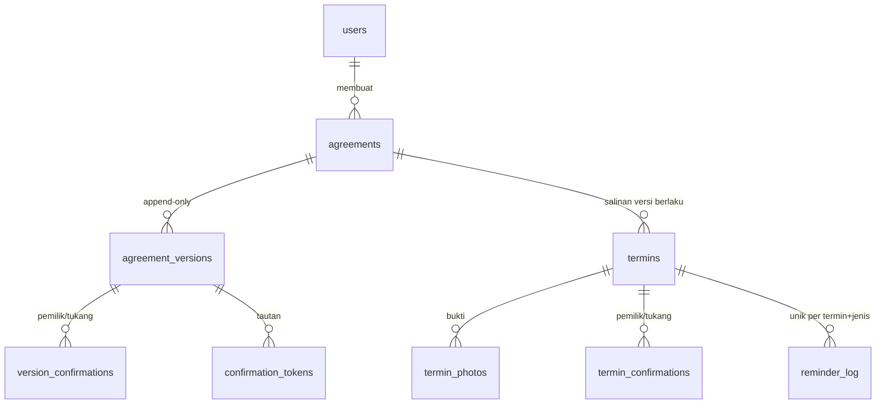

### Lapisan tampilan

| Bagian | Teknologi | Berkas |
|---|---|---|
| Halaman aplikasi dan pihak lawan | Blade + Bootstrap 5 (CDN) | `resources/views/layouts/janji.blade.php` |
| Login, daftar, profil | Blade + Tailwind via Vite (bawaan Breeze) | `layouts/guest.blade.php`, `layouts/app.blade.php` |
| Tema merek (warna, tombol, kartu, gerak) | CSS biasa tanpa build | `public/css/janji.css` |
| Timeline termin | React 18 UMD di-vendor, dengan fallback Blade tanpa JS | `public/js/timeline.js` |
| Logo | PNG | `public/img/` |

Gerak (muncul bertahap, tombol berputar saat kirim) otomatis mati bila pengguna memilih *reduced motion*.

## Menguji

```bash
php artisan test
```

102 tes memakai MySQL `janji_tukang_test`. Tidak ada tes yang memanggil layanan luar (HTTP difake). Vite dimatikan di `TestCase`, jadi tes tidak butuh `npm run build`. Itu juga berarti tes tidak memeriksa tampilan.

## Keputusan

Lengkap di [docs/DECISIONS.md](docs/DECISIONS.md). Ringkas: versi append-only + hash; status versi diturunkan dari konfirmasi; versi berlaku = tertinggi yang disetujui kedua pihak; foto dibuat ulang tanpa EXIF; tautan hanya tampil sekali; pengingat tidak otomatis terkirim.

## Batasan

- **I7:** definisinya ada di `docs/SPEC.md`, yang tidak ada di repo. Isi bagian ini dari spec asli; jangan dianggap sudah dicakup.
- Hash mendeteksi, tidak mencegah, perubahan lewat SQL mentah (tidak ada trigger DB).
- Kode versi adalah penanda integritas internal, bukan tanda tangan elektronik.
- Pengingat butuh pembuat menekan tombol. Driver `sms`/`whatsapp_api` hanya kerangka, nonaktif, belum ada klien.
- Bootstrap masih dimuat dari CDN tanpa SRI, jadi halaman aplikasi dan halaman pihak lawan butuh internet.
- Teks bawaan Breeze (form login dan daftar) masih berbahasa Inggris.

## Author & License

Created by Vassel Goleyu. Copyright (c) 2026 Vassel Goleyu. All rights reserved. Lihat [LICENSE](LICENSE).
