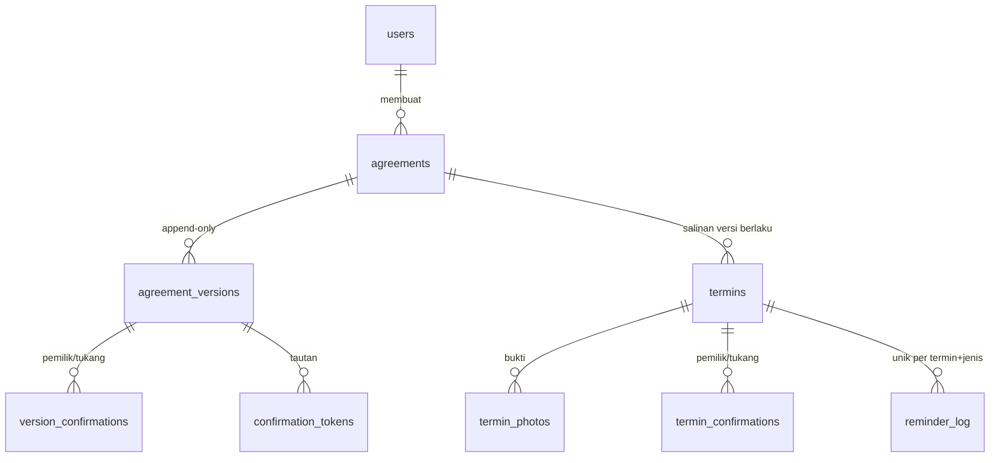

<div align="center">

# 🤝 JANJI TUKANG

**Dari obrolan di teras jadi kesepakatan yang tercatat.**

Catatan kesepakatan kerja renovasi kecil antara pemilik rumah dan tukang/mandor: lingkup, harga, termin bayar, dan foto bukti pekerjaan, semuanya tercatat berdua dan tidak bisa diubah diam-diam.


</div>

---

## Masalah

Kesepakatan renovasi kecil biasanya lisan. Lingkup, harga, dan jadwal bayar jadi kabur, lalu berubah tanpa catatan. Ujungnya sengketa "dulu bilangnya apa".

Janji Tukang memberi kedua pihak satu catatan bersama. Pihak lawan **tidak perlu daftar akun**: cukup buka tautan dari WhatsApp.

> Ini catatan bersama dua pihak, bukan nasihat hukum. Aplikasi tidak memegang uang.

## Tampilan

| Daftar kesepakatan | Wizard 3 langkah |
|---|---|
|  |  |

| Kesepakatan aktif dengan termin dan bukti | Foto sebelum dan sesudah per termin |
|---|---|
|  |  |

| Riwayat versi dan addendum | Halaman pihak lawan (tanpa akun) |
|---|---|
|  |  |

## Fitur utama

- **Wizard 3 langkah**: lingkup, harga, termin. Atau tulis cerita bebas, lalu tinjau draf yang dihasilkan (mode `manual` atau `llm`).
- **Persetujuan lewat tautan WhatsApp**: pihak lawan menerima tautan bertanda tangan, tanpa akun, lalu menyetujui atau meminta perubahan. Tautan dipakai sekali dan punya masa berlaku.
- **Versi append-only berantai hash**: versi lama tidak pernah disunting. Setiap perubahan adalah **addendum** (versi baru) yang juga perlu disetujui kedua pihak.
- **Termin dan bukti foto**: tiap termin butuh foto sebelum dan sesudah. Foto dibuat ulang tanpa EXIF (lokasi tidak bocor) dan terkunci setelah konfirmasi pertama.
- **Konfirmasi dua pihak**: termin selesai hanya bila pemilik dan tukang sama-sama konfirmasi. Waktu dan jejak tercatat di server.
- **Pengingat jatuh tempo**: command harian menandai termin yang jatuh tempo, pembuat menekan tombol untuk mengirim pengingat lewat WhatsApp. Tidak ada kirim otomatis.
- **Cetak**: ringkasan kesepakatan dan riwayat konfirmasi bisa dicetak.

## Alur

1. Pembuat (pemilik atau tukang) mengisi wizard, lalu mengajukan **versi 1**. Pembuat otomatis setuju.
2. Pihak lawan membuka tautan dan menyetujui atau meminta perubahan.
3. Bila kedua pihak setuju, kesepakatan **aktif** dan termin hidup dibuat.
4. Tiap termin: foto sebelum + sesudah, lalu konfirmasi kedua pihak, lalu selesai.
5. Perubahan = addendum. Versi berlaku adalah versi tertinggi yang disetujui kedua pihak.

## Arsitektur singkat

Laravel 13, Blade + Bootstrap, MySQL, Pest. Logika bisnis ada di `app/Services` (`AgreementFlow`, `TerminFlow`, `ConfirmationLink`, `ReminderService`). Pengiriman pesan lewat `ConfirmationNotifier` (`wa_link`, `log`, `sms`, `whatsapp_api`). Draf otomatis lewat `AgreementDrafter` (`manual`, `llm`).



## Menjalankan

```bash
composer install
cp .env.example .env && php artisan key:generate
# buat database MySQL `janji_tukang` dan `janji_tukang_test`, lalu atur DB_* di .env
php artisan migrate
php artisan db:seed --class=DemoSeeder   # data contoh (opsional)
php artisan serve
php artisan schedule:work                # pengingat harian 07:00 (atau: php artisan janji:pengingat)
php artisan queue:work                   # hanya bila memakai driver sms / whatsapp_api
```

Pengaturan ada di `config/janji.php` (env: `JANJI_NOTIFIER`, `JANJI_REMINDER_DAYS`, `JANJI_DRAFTER`, `ANTHROPIC_API_KEY`, `JANJI_LLM_MODEL`).

Catatan: Bootstrap dimuat dari CDN dan React di-vendor di `public/vendor` (lihat [DECISIONS](docs/DECISIONS.md)). Halaman login bawaan Breeze memanggil `@vite`, jadi jalankan `npm install && npm run build` bila mau halaman login tampil.

## Menguji

```bash
php artisan test
```

102 tes memakai MySQL `janji_tukang_test`. Tidak ada tes yang memanggil layanan luar (HTTP difake).

## Keputusan

Lengkap di [docs/DECISIONS.md](docs/DECISIONS.md). Ringkas: versi append-only + hash; status versi diturunkan dari konfirmasi; versi berlaku = tertinggi yang disetujui kedua pihak; foto dibuat ulang tanpa EXIF; tautan hanya tampil sekali; pengingat tidak otomatis terkirim.

## Batasan

- **I7:** definisinya ada di `docs/SPEC.md`, yang tidak ada di repo. Isi bagian ini dari spec asli; jangan dianggap sudah dicakup.
- Hash mendeteksi, tidak mencegah, perubahan lewat SQL mentah (tidak ada trigger DB).
- Kode versi adalah penanda integritas internal, bukan tanda tangan elektronik.
- Pengingat butuh pembuat menekan tombol. Driver `sms`/`whatsapp_api` hanya kerangka, nonaktif, belum ada klien.

## Author & License

Created by Vassel Goleyu. Copyright (c) 2026 Vassel Goleyu. All rights reserved. Lihat [LICENSE](LICENSE).
