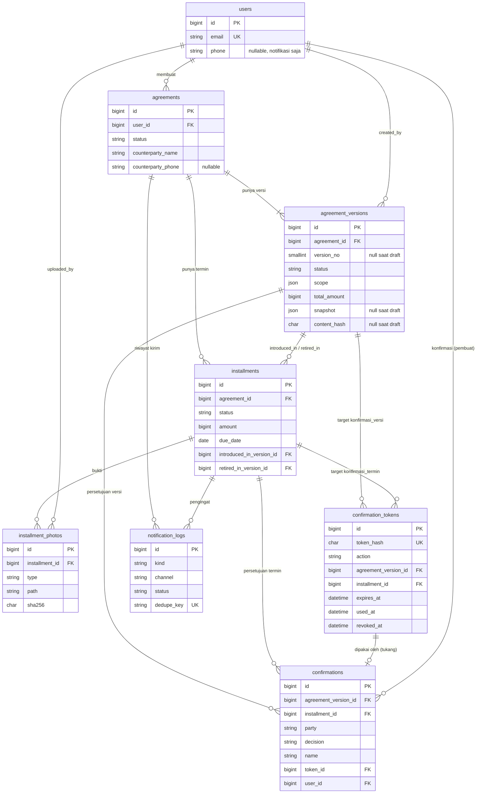
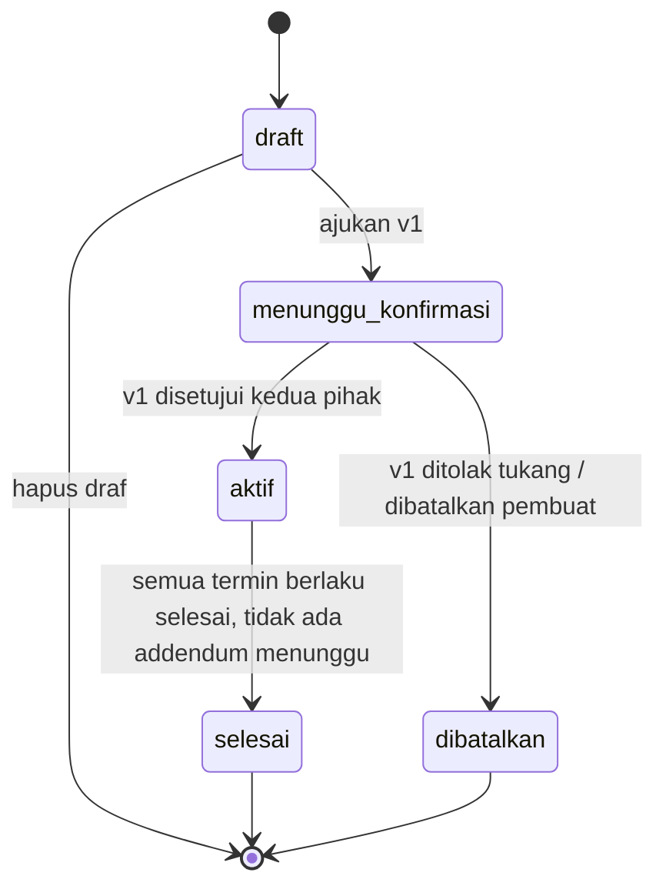
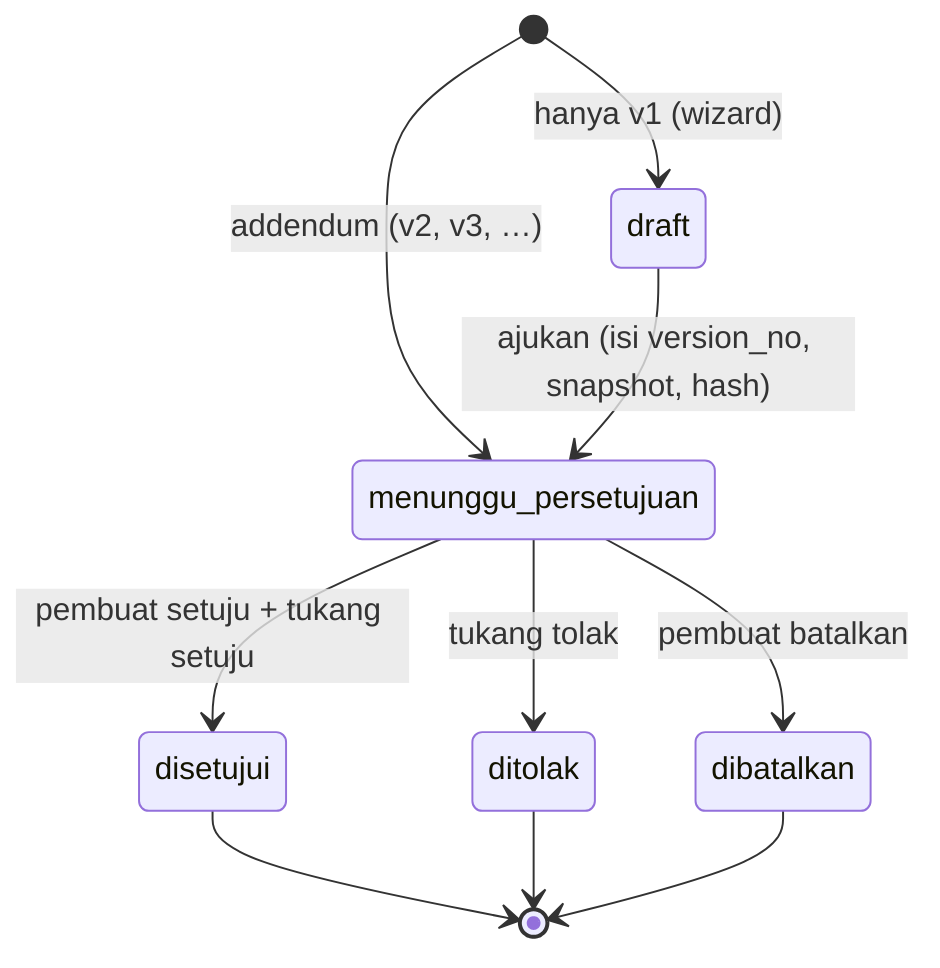
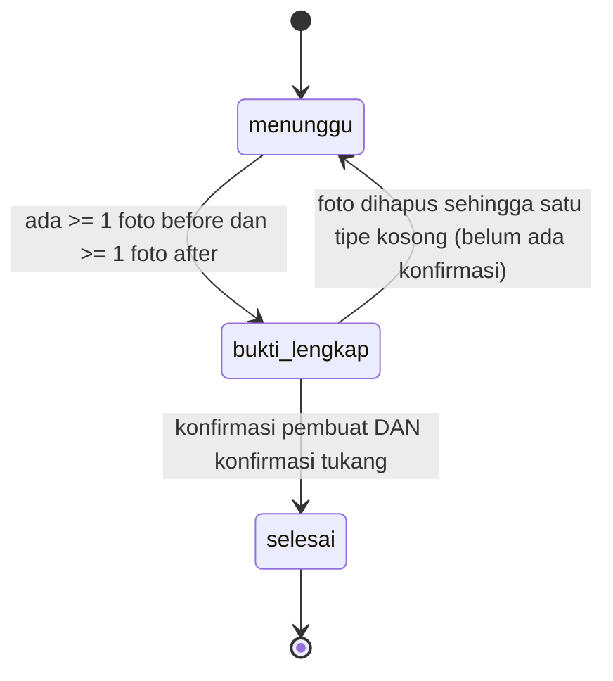
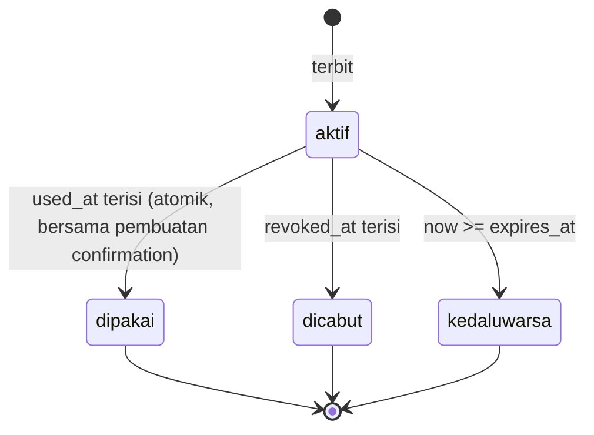

<!-- Copyright (c) 2026 Vassel Goleyu. All rights reserved. -->
# Desain Janji Tukang (MVP)

Status: Step 1, menunggu persetujuan. Asumsi dasar ada di [assumptions.md](assumptions.md). Keputusan terbuka dan pilihan saya ada di bagian 11 (D-01 sampai D-22). Matriks keterlacakan aturan → desain ada di bagian 12.

## 0. Keputusan kunci (ringkas)

1. **Termin ↔ addendum (D-01).** Tabel `installments` adalah catatan operasional yang hidup, milik kesepakatan (bukan milik versi). Setiap versi menyimpan **rencana termin** di dalam `snapshot` JSON-nya. Saat addendum disetujui, rencana itu diterapkan ke tabel `installments`. Jejak riwayat ada di snapshot versi yang tidak pernah berubah, ditambah `introduced_in_version_id` dan `retired_in_version_id` di tiap termin. Foto dan konfirmasi termin tidak pernah ikut tersalin atau berpindah.
2. **Draf v1 (D-02).** Wizard menulis ke satu baris `agreement_versions` berstatus `draft` tanpa `version_no`. `version_no`, `snapshot`, dan `content_hash` baru diisi saat diajukan. Sejak `submitted_at` terisi, versi immutable.
3. **Konfirmasi pembuat di dalam aplikasi (D-03).** Tautan token hanya untuk tukang. Bukti yang disimpan sama persis untuk kedua pihak.
4. **Token tidak bisa dibaca ulang (D-04).** Hanya hash yang disimpan, jadi "salin tautan" membuat token baru dan mencabut token lama untuk target yang sama.
5. **Total aktif** = `total_amount` dari versi dengan `version_no` tertinggi yang berstatus `disetujui`.

## 1. Arsitektur dan struktur kode

Monolit Laravel + Blade + Bootstrap 5 (Vite). MySQL. Queue `database`. Tanpa API eksternal selain placeholder WhatsApp/SMS.

```
app/
  Enums/        AgreementStatus, VersionStatus, InstallmentStatus, PhotoType, Party,
                Decision, TokenAction, NotificationKind, NotificationStatus
  Models/       User, Agreement, AgreementVersion, Installment, InstallmentPhoto,
                ConfirmationToken, Confirmation, NotificationLog
  Policies/     satu per model (bagian 10)
  Http/
    Controllers/  Wizard, Agreement, Version(Addendum), Installment, Photo, Link, Konfirmasi (publik)
    Requests/     satu Form Request per aksi tulis
  Services/
    VersionService          ajukan v1, buat addendum, batalkan, setujui + terapkan
    SnapshotHasher          bangun snapshot kanonik, hash, verifikasi
    InstallmentService      foto, perpindahan status
    PhotoStore              validasi lanjutan, orient, hapus EXIF, simpan ke disk private
    ConfirmationService     catat konfirmasi (pembuat dan tukang) dalam satu transaksi
    ConfirmationTokenService  terbitkan, cari, pakai (atomik), cabut
    ReminderService         pilih termin yang diingatkan
  Notifications/
    Contracts/NotificationChannel   send(NotificationMessage): void
    Channels/  LogChannel, WhatsAppChannel (placeholder), SmsChannel (placeholder)
    Notifier                buat log + dispatch job
  Jobs/SendNotificationJob  ShouldQueue, ShouldBeEncrypted, tries=5, backoff
  Console/Commands/KirimPengingat  janji:kirim-pengingat
config/janji.php            semua angka yang bisa diatur (bagian 9.4)
lang/id/                    validasi, UI, persetujuan (teks per versi)
```

Aturan lintas modul: perpindahan status hanya lewat enum `canTransitionTo()` yang dipanggil service. Controller tidak mengubah status langsung. Semua aksi multi-tabel berjalan di `DB::transaction` dengan `lockForUpdate()` pada baris `agreements`.

## 2. ERD



## 3. Tabel

Konvensi: nama tabel dan kolom bahasa Inggris snake_case (konsisten dengan prompt); **nilai enum** bahasa Indonesia seperti di prompt. Semua FK `ON DELETE RESTRICT` kecuali disebut lain. Semua tabel memakai `created_at`/`updated_at` kecuali disebut lain. Enum disimpan sebagai `VARCHAR` dengan cast enum PHP (mudah diubah tanpa migration yang berat).

### 3.1 `users` (pembuat)
| Kolom | Tipe | Catatan |
|---|---|---|
| id | bigint unsigned PK | |
| name | varchar(100) | |
| email | varchar(190) | unique |
| email_verified_at | timestamp null | disiapkan, verifikasi email di luar MVP |
| password | varchar(255) | bcrypt/argon dari Laravel |
| phone | varchar(20) null | format normalisasi `62…`, **hanya untuk notifikasi** |
| remember_token | varchar(100) null | |

Index: `UNIQUE(email)`.

### 3.2 `agreements`
| Kolom | Tipe | Catatan |
|---|---|---|
| id | bigint unsigned PK | |
| user_id | FK users | pemilik (pembuat) |
| title | varchar(150) | mis. "Renovasi kamar mandi kos Blok B" |
| counterparty_name | varchar(100) | nama tukang/mandor |
| counterparty_phone | varchar(20) null | hanya notifikasi |
| status | varchar(30) | `draft` `menunggu_konfirmasi` `aktif` `selesai` `dibatalkan` |
| activated_at | timestamp null | saat v1 disetujui |
| closed_at | timestamp null | saat `selesai` atau `dibatalkan` |

Index: `(user_id, status)` untuk daftar; `(status)`.
`title` dan `counterparty_name` terkunci setelah v1 diajukan (sudah tersalin di snapshot). `counterparty_phone` boleh diubah kapan saja (bukan bagian snapshot).

### 3.3 `agreement_versions`
| Kolom | Tipe | Catatan |
|---|---|---|
| id | bigint unsigned PK | |
| agreement_id | FK agreements | |
| version_no | smallint unsigned null | 1, 2, 3, … Diisi saat diajukan. Tidak pernah dipakai ulang walau versi ditolak atau dibatalkan |
| status | varchar(30) | `draft` `menunggu_persetujuan` `disetujui` `ditolak` `dibatalkan` |
| scope | json | `{description, location, items[], notes}`; boleh diubah **hanya** saat `draft` |
| total_amount | bigint unsigned | rupiah bulat, min 1. Null saat draf belum diisi |
| reason | text null | alasan perubahan (wajib untuk addendum) |
| snapshot | json null | snapshot lengkap (bagian 4). Null saat draf |
| content_hash | char(64) null | SHA-256 hex dari snapshot kanonik |
| previous_hash | char(64) null | `content_hash` versi `version_no - 1` (rantai) |
| hash_schema | tinyint unsigned null | versi skema snapshot (awal: 1) |
| created_by | FK users | |
| submitted_at | timestamp null | **penanda immutable** |
| approved_at | timestamp null | |
| closed_at | timestamp null | saat `ditolak` atau `dibatalkan` |
| open_slot | tinyint **generated stored** | `CASE WHEN status IN ('draft','menunggu_persetujuan') THEN 1 END` |

Index/constraint:
- `UNIQUE(agreement_id, version_no)` (NULL pada draf diizinkan berulang oleh MySQL).
- `UNIQUE(agreement_id, open_slot)`: maksimal satu versi terbuka per kesepakatan (D-05).
- `INDEX(agreement_id, status, version_no)`: mencari versi aktif (`status='disetujui'` urut `version_no` desc, limit 1).
- `CHECK (total_amount IS NULL OR total_amount > 0)`.
- `CHECK ((status = 'draft') = (submitted_at IS NULL))`: draf ⇔ belum diajukan.

Immutability: lihat bagian 4.3.

### 3.4 `installments` (termin)
| Kolom | Tipe | Catatan |
|---|---|---|
| id | bigint unsigned PK | |
| agreement_id | FK agreements | |
| position | smallint unsigned | urutan tampil; dibuat sekali, tidak berubah setelah v1 diajukan |
| title | varchar(150) | |
| amount | bigint unsigned | rupiah bulat, `CHECK (amount > 0)` |
| due_date | date null | opsional |
| release_condition | text | kondisi pencairan |
| status | varchar(30) | `menunggu` `bukti_lengkap` `selesai` |
| proof_completed_at | timestamp null | saat masuk `bukti_lengkap` |
| completed_at | timestamp null | saat masuk `selesai` |
| introduced_in_version_id | FK agreement_versions null | null hanya saat draf v1 |
| retired_in_version_id | FK agreement_versions null | versi addendum yang membuang termin ini |

Index: `UNIQUE(agreement_id, position)`; `INDEX(due_date, status)` untuk scheduler; `INDEX(agreement_id, retired_in_version_id)`.

Termin "berlaku" = `retired_in_version_id IS NULL`. Invarian: untuk versi aktif, `SUM(amount)` termin berlaku = total aktif.

### 3.5 `installment_photos`
| Kolom | Tipe | Catatan |
|---|---|---|
| id | bigint unsigned PK | |
| installment_id | FK installments | |
| type | varchar(10) | `before` `after` |
| path | varchar(255) | path di disk `private`, nama acak (ULID) |
| mime | varchar(20) | `image/jpeg` `image/png` `image/webp` |
| size_bytes | int unsigned | ukuran setelah diproses |
| sha256 | char(64) | hash berkas setelah EXIF dihapus |
| uploaded_by | FK users | |
| uploaded_at | timestamp | |

Index: `(installment_id, type)`. Tanpa `updated_at`.

### 3.6 `confirmation_tokens`
| Kolom | Tipe | Catatan |
|---|---|---|
| id | bigint unsigned PK | |
| token_hash | char(64) | SHA-256 hex dari token mentah; **unique** |
| action | varchar(30) | `konfirmasi_versi` `konfirmasi_termin` |
| agreement_id | FK agreements | denormalisasi untuk pencabutan massal dan otorisasi |
| agreement_version_id | FK null | terisi jika `action = konfirmasi_versi` (v1 atau addendum) |
| installment_id | FK null | terisi jika `action = konfirmasi_termin` |
| expires_at | datetime | default `now + 7 hari` (`JANJI_TOKEN_TTL_DAYS`) |
| used_at | datetime null | |
| revoked_at | datetime null | |
| created_by | FK users | |
| created_at | timestamp | tanpa `updated_at` |

Constraint: `CHECK ((action='konfirmasi_versi' AND agreement_version_id IS NOT NULL AND installment_id IS NULL) OR (action='konfirmasi_termin' AND installment_id IS NOT NULL AND agreement_version_id IS NULL))`.
Index: `UNIQUE(token_hash)`; `(agreement_version_id)`; `(installment_id)`; `(agreement_id, expires_at)`.
Token mentah: 32 byte dari `random_bytes`, dikodekan base64url (43 karakter). Satu token = satu `action` + satu target. Token selalu untuk pihak `tukang`.

### 3.7 `confirmations`
| Kolom | Tipe | Catatan |
|---|---|---|
| id | bigint unsigned PK | |
| agreement_version_id | FK null | target versi |
| installment_id | FK null | target termin |
| party | varchar(10) | `pembuat` `tukang` |
| decision | varchar(10) | `setuju` `tolak` (`tolak` hanya valid untuk versi, dan hanya oleh tukang) |
| name | varchar(100) | nama yang diketik |
| note | text null | alasan penolakan |
| consent_checked | boolean | selalu true; kolom disimpan sebagai bukti kotak persetujuan eksplisit |
| text_version | varchar(20) | versi teks persetujuan, mis. `v1` |
| content_hash | char(64) | versi: `content_hash` snapshot yang disetujui. Termin: hash bukti (bagian 7.3) |
| token_id | FK confirmation_tokens null, **unique** | terisi untuk `tukang` |
| user_id | FK users null | terisi untuk `pembuat` |
| ip | varchar(45) | IPv4/IPv6 |
| user_agent | varchar(512) | dipotong 512 |
| created_at | timestamp | waktu konfirmasi; tanpa `updated_at` |

Constraint:
- `CHECK` tepat satu target: `(agreement_version_id IS NULL) <> (installment_id IS NULL)`.
- `CHECK` identitas: `(party='pembuat' AND user_id IS NOT NULL AND token_id IS NULL) OR (party='tukang' AND token_id IS NOT NULL AND user_id IS NULL)`.
- `UNIQUE(agreement_version_id, party)` dan `UNIQUE(installment_id, party)`: tiap pihak hanya satu keputusan per target.
- `UNIQUE(token_id)`: satu token menghasilkan paling banyak satu konfirmasi.

### 3.8 `notification_logs`
| Kolom | Tipe | Catatan |
|---|---|---|
| id | bigint unsigned PK | |
| agreement_id | FK null | |
| installment_id | FK null | |
| kind | varchar(30) | `konfirmasi_diminta` `pengingat_besok` `pengingat_terlambat` |
| channel | varchar(20) | `log` `whatsapp` `sms` |
| recipient_party | varchar(10) | `pembuat` `tukang` |
| recipient_masked | varchar(20) | mis. `62812****789`. Nomor asli tidak diduplikasi di sini |
| dedupe_key | varchar(120) null | **unique**; membuat pengingat idempoten |
| status | varchar(15) | `antri` `terkirim` `gagal` |
| attempts | smallint unsigned | |
| error | text null | pesan error terakhir (tanpa token/tautan) |
| sent_at | timestamp null | |

Index: `UNIQUE(dedupe_key)`; `(agreement_id, created_at)`; `(status)`. Isi pesan **tidak** disimpan, karena bisa memuat tautan token. Isi pesan hanya ada di payload job yang terenkripsi.

### 3.9 Tabel framework
`password_reset_tokens`, `sessions`, `cache`, `cache_locks`, `jobs`, `failed_jobs`, `migrations`.

## 4. Snapshot, hash, dan immutability

### 4.1 Isi snapshot (skema 1)
```json
{
  "schema": 1,
  "agreement_id": 12,
  "version_no": 2,
  "previous_hash": "…64 hex… | null",
  "title": "Renovasi kamar mandi kos Blok B",
  "parties": { "pembuat": "Nama Pembuat", "tukang": "Nama Tukang" },
  "scope": { "description": "…|null", "location": "Kamar mandi lantai 2", "items": ["…"], "notes": "…|null" },
  "total_amount": 15000000,
  "installments": [
    { "installment_id": 31, "position": 1, "title": "Uang muka", "amount": 5000000,
      "due_date": "2026-12-01", "release_condition": "…" }
  ],
  "reason": "…|null"
}
```
`installment_id` bernilai null untuk termin baru yang diusulkan addendum dan belum ada barisnya.

### 4.2 Pembuatan dan verifikasi hash
1. Bangun array snapshot dari data draf/usulan. `installments` diurut `position`.
2. Normalisasi string: `trim`, `\r\n` → `\n`, string kosong → `null`. Bilangan selalu integer. Tanggal `Y-m-d`.
3. Kanonikalisasi: urutkan kunci objek secara rekursif (A–Z byte), daftar tetap berurutan. `json_encode` dengan `JSON_UNESCAPED_UNICODE | JSON_UNESCAPED_SLASHES | JSON_THROW_ON_ERROR`, tanpa spasi.
4. `content_hash = hash('sha256', string_kanonik)`.
5. Verifikasi (`SnapshotHasher::verify`): kanonikalisasi ulang kolom `snapshot` dari DB (urutan kunci JSON MySQL tidak berpengaruh karena diurutkan ulang), bandingkan dengan `content_hash`; cek `snapshot.total_amount == total_amount`, `snapshot.scope == scope`, dan `previous_hash` sama dengan hash versi sebelumnya.
6. `hash_schema` memungkinkan algoritma diubah kelak tanpa merusak verifikasi versi lama.

### 4.3 Immutability versi
Setelah `submitted_at` terisi:
- Kolom `scope`, `total_amount`, `reason`, `snapshot`, `content_hash`, `previous_hash`, `hash_schema`, `version_no`, `created_by`, `submitted_at` **tidak boleh berubah**. Hanya `status`, `approved_at`, `closed_at`, `updated_at` yang boleh.
- Penjaga di model (`updating`/`deleting` melempar `ImmutableVersionException`), plus `CHECK` di bagian 3.3, plus FK `RESTRICT`.
- Tes (Step 4 dan 7): ubah atribut terlarang → exception; hapus → exception; setelah addendum disetujui, snapshot v1 masih identik byte-per-byte dan hash v1 tetap valid.
- Batas yang diketahui: `DB::table()->update()` mentah melewati penjaga model. Pengerasan lewat trigger MySQL ditunda (D-14).

## 5. State machine

Perpindahan di luar tabel dilarang dan ditolak oleh `canTransitionTo()`.

### 5.1 Kesepakatan (`agreements.status`)

| Dari → Ke | Pemicu | Guard | Aktor |
|---|---|---|---|
| draft → menunggu_konfirmasi | Ajukan | lingkup valid, total ≥ 1, ≥ 1 termin, `SUM(termin) = total` | pembuat |
| draft → (hapus) | Hapus draf | belum pernah diajukan | pembuat |
| menunggu_konfirmasi → aktif | Konfirmasi ke-2 `setuju` pada v1 | kedua `confirmations` ada | sistem |
| menunggu_konfirmasi → dibatalkan | v1 `ditolak` atau `dibatalkan` | | tukang / pembuat |
| aktif → selesai | Termin terakhir `selesai`, atau addendum menunggu ditutup | semua termin berlaku `selesai` dan tidak ada versi `menunggu_persetujuan` | sistem (`refreshStatus`) |

Addendum hanya boleh dibuat saat `aktif`. `selesai` dan `dibatalkan` terminal.

### 5.2 Versi / addendum (`agreement_versions.status`)

| Dari → Ke | Guard | Efek samping |
|---|---|---|
| (baru) → menunggu_persetujuan (addendum) | agreement `aktif`; tidak ada versi terbuka; `reason` terisi; `SUM(plan) = total`; aturan termin terkunci (D-06) | `version_no = max + 1`; snapshot + hash; `previous_hash`; terbitkan token tukang (opsional, atas permintaan) |
| draft → menunggu_persetujuan (v1) | lihat 5.1 | `introduced_in_version_id` termin diisi v1; agreement → `menunggu_konfirmasi` |
| menunggu_persetujuan → disetujui | dua konfirmasi `setuju`; **validasi ulang** kecocokan rencana dengan termin hidup (D-07) | `approved_at`; terapkan rencana ke `installments` (addendum); agreement → `aktif` (v1); cabut token tersisa |
| menunggu_persetujuan → ditolak | konfirmasi tukang `decision = tolak` | `closed_at`; cabut token; v1: agreement → `dibatalkan` |
| menunggu_persetujuan → dibatalkan | oleh pembuat | `closed_at`; cabut token; v1: agreement → `dibatalkan`; `refreshStatus` |

Versi yang lewat masa token tetap `menunggu_persetujuan`; pembuat bisa menerbitkan tautan baru atau membatalkan (tidak ada kedaluwarsa otomatis pada versi).
**Total aktif** = `total_amount` versi `disetujui` dengan `version_no` tertinggi.

### 5.3 Termin (`installments.status`)

| Dari → Ke | Guard | Aktor |
|---|---|---|
| menunggu → bukti_lengkap | agreement `aktif`; termin berlaku; jumlah foto memenuhi minimum | sistem setelah upload |
| bukti_lengkap → menunggu | belum ada `confirmations` untuk termin; hapus foto membuat tipe kosong | sistem setelah hapus foto |
| bukti_lengkap → selesai | dua `confirmations` `setuju` (pembuat + tukang) | sistem setelah konfirmasi ke-2 |

Aturan terkait: konfirmasi hanya diterima saat `bukti_lengkap`. Konfirmasi pertama (siapa pun) **mengunci foto** (tambah dan hapus ditolak). Konfirmasi bersifat final (D-15). Tidak ada lompatan `menunggu → selesai`.

### 5.4 Token (`confirmation_tokens`)
Status diturunkan dari kolom, tidak disimpan:

Token "valid" jika `used_at IS NULL AND revoked_at IS NULL AND expires_at > now()` **dan** target masih dapat ditindak (versi `menunggu_persetujuan` atau termin `bukti_lengkap` pada agreement `aktif`).
Pemicu pencabutan: penerbitan token baru untuk target yang sama; target keluar dari keadaan dapat ditindak (versi ditutup, termin `selesai`); pembuat mencabut manual.

## 6. Tautan konfirmasi

### 6.1 Penerbitan
1. Pembuat memilih "Buat tautan konfirmasi" untuk target (versi atau termin). Policy `generateLink`.
2. `ConfirmationTokenService::issue(target)`: transaksi → cabut token aktif lain untuk target itu → `raw = base64url(random_bytes(32))` → simpan `sha256(raw)` dan `expires_at = now + config('janji.token.ttl_days')`.
3. URL = `URL::temporarySignedRoute('konfirmasi.show', expires_at, ['token' => raw])`. Kedaluwarsa tanda tangan sama dengan `expires_at`.
4. Token mentah ditampilkan **sekali** ke pembuat (flash) untuk disalin, dan/atau dikirim lewat `Notifier` (job terenkripsi). Tidak pernah masuk log, tidak masuk `notification_logs`.

### 6.2 Penggunaan (`/k/{token}`)
| Langkah | GET (lihat) | POST (konfirmasi) |
|---|---|---|
| 1 | Middleware `throttle` + `signed` (tanda tangan/expiry Laravel) | sama |
| 2 | `token_hash = sha256(token)`; cari baris; tidak ada → 404 generik | sama |
| 3 | Periksa `used_at`, `revoked_at`, `expires_at`, kondisi target → halaman pesan khusus (sudah dipakai / dicabut / kedaluwarsa / tidak berlaku lagi) | sama, di dalam transaksi dengan `lockForUpdate` pada baris token dan target |
| 4 | Render **snapshot lengkap** + hash + teks persetujuan + formulir | Form Request: `name` (wajib, 2–100), `consent` (accepted), `decision` (`setuju`/`tolak`; `tolak` hanya untuk versi; `note` wajib jika tolak) |
| 5 | GET **tidak** menghabiskan token (pratinjau tautan WhatsApp aman) | `UPDATE … SET used_at = now() WHERE id=? AND used_at IS NULL AND revoked_at IS NULL AND expires_at > now()`; hasil bukan 1 baris → gagal. Lalu buat `confirmations`. Satu transaksi |

Perlindungan tambahan: CSRF aktif untuk POST (halaman GET memulai sesi); respons memakai header `Cache-Control: no-store` dan `Referrer-Policy: no-referrer` agar token tidak bocor lewat riwayat/referer; `X-Robots-Tag: noindex`.
Pesan error untuk token tak dikenal selalu sama (tidak membocorkan keberadaan).

### 6.3 Data bukti yang disimpan
`confirmations`: waktu (`created_at`), `ip`, `user_agent`, `name` (diketik), `text_version`, `consent_checked`, `decision`, `content_hash` (apa yang disetujui), serta `token_id` atau `user_id`.
Teks persetujuan per versi di `lang/id/persetujuan.php` (kunci `v1`, `v2`, …). Teks versi yang sudah dipakai tidak pernah diubah; perubahan = versi baru. Teks tidak memakai kata "sah" atau "mengikat secara hukum".

### 6.4 Rate limit
Named limiter di `AppServiceProvider` (angka di `config/janji.php`, bagian 9.4):
- `konfirmasi-lihat` (GET): 30/menit per IP **dan** 10/menit per IP + hash token.
- `konfirmasi-kirim` (POST): 10/menit per IP **dan** 5/menit per hash token.
Melebihi batas → 429 dengan halaman Bahasa Indonesia. Login pembuat: 5 percobaan/menit per email+IP.

## 7. Konfirmasi dan alur per fase

### 7.1 Konfirmasi versi (v1 dan addendum)
`ConfirmationService::confirmVersion(version, party, payload)`, transaksi: kunci baris agreement dan versi → versi harus `menunggu_persetujuan` → simpan `confirmations` (unique mencegah ganda) → jika `tolak`: tutup versi (5.2) → jika dua `setuju`: `VersionService::approve` (set `disetujui`, terapkan rencana, ubah agreement) → semua dalam transaksi yang sama.
Pembuat: `POST /versi/{v}/konfirmasi` (login, policy `confirm`, Form Request sama). Tukang: lewat token.

### 7.2 Penerapan rencana termin saat addendum disetujui
Untuk tiap entri `snapshot.installments`:
- `installment_id` ada → termin hidup diperbarui (judul, nominal, jatuh tempo, kondisi) bila berbeda. Hanya boleh pada termin `menunggu` tanpa foto; termin lain harus identik.
- `installment_id` null → buat termin baru (`position = max + 1`, `introduced_in_version_id = version.id`).
Termin hidup yang tidak ada di rencana → `retired_in_version_id = version.id` (hanya boleh jika `menunggu` tanpa foto).
Setelah itu `SUM(termin berlaku) = total_amount` versi diperiksa lagi sebagai pagar terakhir (lempar exception dan batalkan transaksi bila tidak sama).

### 7.3 Konfirmasi termin
Syarat: agreement `aktif`, termin berlaku dan `bukti_lengkap`. Pembuat: login. Tukang: token `konfirmasi_termin`. `confirmations.content_hash` = `sha256` dari `{installment_id, title, amount, due_date, release_condition, [sha256 semua foto, urut type lalu uploaded_at]}` dikanonikalkan seperti 4.2. Halaman konfirmasi tukang menampilkan rincian termin dan foto sebelum/sesudah (URL sementara). Konfirmasi ke-2 `setuju` → `selesai`, `completed_at`, `refreshStatus` agreement, cabut token tersisa.

### 7.4 Foto
Aturan unggah (`StorePhotoRequest` + `PhotoStore`):
- Rule `image`, `mimes:jpg,jpeg,png,webp`, `max:5120` (KB), `dimensions:max_width=8000,max_height=8000`; MIME diperiksa dari isi berkas, bukan ekstensi.
- Maksimal 5 foto per tipe per termin (`janji.photo.per_type_max`).
- Pemrosesan: Intervention Image v3 (driver GD): `orient()` (terapkan rotasi EXIF dulu) → encode ulang pada format asal (jpeg/webp kualitas 85, png). Encode ulang GD **tidak membawa metadata**, jadi EXIF/GPS hilang. Ukuran dan `sha256` dihitung dari hasil akhir; berkas asli unggahan tidak disimpan.
- Simpan di disk `private` (root `storage/app/private`, tidak ter-link ke `public`), path `installments/{agreement_id}/{installment_id}/{ulid}.{ext}`.
- Akses hanya lewat `Storage::disk('private')->temporaryUrl()` (disk lokal `serve=true`), TTL 5 menit, dibuat per render halaman. Tidak ada URL permanen.
- Tes Step 5: JPEG fixture dengan GPS EXIF → setelah simpan, `exif_read_data` tidak memuat GPS.

## 8. Notifikasi

```php
interface NotificationChannel {
    public function name(): string;
    public function send(NotificationMessage $message): void; // lempar exception jika gagal
}
```
`NotificationMessage` (DTO): `kind`, `recipientParty`, `phone`, `text`, `agreementId`, `installmentId`, `dedupeKey`.
- **LogChannel**: menulis ke log channel `notifications` (tanpa tautan lengkap pada level info; tautan hanya di level debug untuk pengembangan). Dipakai di `local` dan tes.
- **WhatsAppChannel**, **SmsChannel**: placeholder. Konfigurasi `.env` dibaca lewat `config/janji.php`; jika kredensial kosong, `send()` melempar `ChannelNotConfigured` (job gagal dan tercatat). Tidak ada panggilan jaringan pada MVP.
- Pemilihan channel: `NOTIFICATION_CHANNEL=log|whatsapp|sms`; binding container memilih satu implementasi.
- **Notifier**: terima `NotificationMessage` → insert `notification_logs` (`antri`; jika `dedupe_key` sudah ada → lewati, idempoten) → `SendNotificationJob::dispatch($logId, $message)`.
- **SendNotificationJob**: `ShouldQueue`, `ShouldBeEncrypted` (payload membawa tautan token), `tries = 5`, `backoff = [60, 300, 900, 3600]` detik, `attempts++` tiap percobaan; sukses → `terkirim` + `sent_at`; `failed()` → `gagal` + `error`.
- Pembuat tetap bisa menyalin tautan manual dari halaman kesepakatan/termin (6.1).

### 8.1 Pengingat (scheduler)
`php artisan janji:kirim-pengingat`, terjadwal `dailyAt('08:00')`, zona `Asia/Jakarta`, `withoutOverlapping()`, `onOneServer()`. Perintah memakai `today()`/`now()` Carbon sehingga tes memakai `Carbon::setTestNow()`.

Kriteria (`ReminderService`): agreement `aktif`; termin berlaku (`retired_in_version_id IS NULL`); `status <> 'selesai'`; `due_date` tidak null.
| Jenis | Kondisi | `dedupe_key` |
|---|---|---|
| `pengingat_besok` | `due_date = today + 1` | `pengingat_besok:{installment}:{party}:{Y-m-d hari ini}` |
| `pengingat_terlambat` | `today - 7 hari <= due_date < today` (batas `reminders.overdue_max_days`) | `pengingat_terlambat:{installment}:{party}:{Y-m-d hari ini}` |

Penerima: kedua pihak yang punya nomor telepon. Isi untuk pembuat memuat tautan ke halaman termin (butuh login); untuk tukang hanya informasi (judul, nominal, tanggal), **tanpa token**. Menjalankan perintah dua kali pada hari yang sama tidak mengirim ganda (unique `dedupe_key`).

## 9. Keamanan dan konfigurasi

### 9.1 Otorisasi
Pembuat hanya melihat dan mengubah kesepakatannya sendiri. Satu Policy per model; semua berpangkal pada `agreement.user_id === auth()->id()`:
| Policy | Aturan inti |
|---|---|
| UserPolicy | hanya diri sendiri |
| AgreementPolicy | `view/update/delete/submit/cancel/createAddendum/generateLink`; `update` hanya `draft`; `delete` hanya `draft`; `createAddendum` hanya `aktif` |
| AgreementVersionPolicy | `view`, `confirm` (pembuat; versi `menunggu_persetujuan`), `cancel`; tidak ada `update/delete` setelah `submitted_at` |
| InstallmentPolicy | `view`, `uploadPhoto`/`confirm` (agreement `aktif`, termin berlaku), `generateLink` |
| InstallmentPhotoPolicy | `view`, `delete` (hanya jika belum ada konfirmasi) |
| ConfirmationTokenPolicy | `revoke`, `view` metadata (bukan token mentah) |
| ConfirmationPolicy | `view` (lewat agreement milik sendiri); tanpa update/delete |
| NotificationLogPolicy | `view` (lewat agreement milik sendiri) |
`Gate::before` tidak dipakai. Route publik tidak memakai policy; otorisasinya adalah validasi token (bagian 6).

### 9.2 Peta route
| Route | Method | Middleware | Otorisasi |
|---|---|---|---|
| `/login`, `/logout` | GET/POST | `guest` / `auth`, throttle login | tidak ada |
| `/` → `agreements.index` | GET | `auth` | daftar milik sendiri (scope query `user_id`) |
| `agreements` create/store, `show`, `destroy` | | `auth` | AgreementPolicy |
| `agreements/{a}/lingkup`, `/harga`, `/termin` | GET/PUT | `auth` | `update` (draft) |
| `agreements/{a}/ajukan` | POST | `auth` | `submit` |
| `agreements/{a}/ringkasan` | GET | `auth` | `view` (halaman cetak) |
| `agreements/{a}/addendum` | GET/POST | `auth` | `createAddendum` |
| `versi/{v}` (lihat), `versi/{v}/batal`, `versi/{v}/konfirmasi` | GET/POST | `auth` | AgreementVersionPolicy |
| `versi/{v}/tautan`, `termin/{i}/tautan` | POST | `auth` | `generateLink` |
| `tautan/{t}` | DELETE | `auth` | ConfirmationTokenPolicy `revoke` |
| `termin/{i}`, `termin/{i}/foto`, `foto/{p}` (DELETE), `termin/{i}/konfirmasi` | | `auth` | InstallmentPolicy / PhotoPolicy |
| `k/{token}` | GET | `signed`, `throttle:konfirmasi-lihat` | validasi token |
| `k/{token}` | POST | `signed`, `throttle:konfirmasi-kirim`, CSRF | validasi token |

Route model binding memakai `scopeBindings` untuk route bersarang agar ID dari kesepakatan lain ditolak 404. Semua query memakai Eloquent/query builder dengan parameter binding; tanpa `DB::raw` yang menyambung input.

### 9.3 Privasi
Hanya `name`, `email`, `phone` (pembuat) dan `counterparty_name`, `counterparty_phone` (tukang). Tanpa NIK, rekening, atau alamat. Telepon hanya dipakai `Notifier`; log memakai nomor tersamar. Log aplikasi tidak mencetak token, tautan, atau nomor telepon utuh.

### 9.4 `config/janji.php` dan `.env`
| Kunci | Env | Default |
|---|---|---|
| `token.ttl_days` | `JANJI_TOKEN_TTL_DAYS` | 7 |
| `token.bytes` | | 32 (minimum, dijaga tes) |
| `consent.version` | | `v1` |
| `photo.max_kb` / `photo.per_type_max` / `photo.url_ttl_minutes` | | 5120 / 5 / 5 |
| `money.max` | | 99999999999 |
| `reminders.overdue_max_days` / `reminders.send_at` | | 7 / `08:00` |
| `rate.konfirmasi_lihat_ip` / `rate.konfirmasi_kirim_ip` / `rate.konfirmasi_kirim_token` | | 30 / 10 / 5 per menit |
| `notification.channel` | `NOTIFICATION_CHANNEL` | `log` |
| `notification.whatsapp.{url,token,sender}` | `WHATSAPP_API_URL`, `WHATSAPP_API_TOKEN`, `WHATSAPP_SENDER` | kosong |
| `notification.sms.{url,key,sender}` | `SMS_API_URL`, `SMS_API_KEY`, `SMS_SENDER_ID` | kosong |
Lokalisasi: `APP_LOCALE=id`, `APP_TIMEZONE=Asia/Jakarta`, `faker_locale=id_ID`; rupiah diformat helper `Rupiah::format(15000000)` → `Rp 15.000.000`.

## 10. Wizard dan ringkasan (acuan Step 3)
- Langkah 1 **Lingkup**: `title`, `counterparty_name`, `counterparty_phone` (opsional), `location`, `description` dan/atau `items[]`, `notes`. Wajib `location`, serta `description` atau minimal satu item. Menulis ke draf versi (`scope`) dan `agreements`.
- Langkah 2 **Harga**: `total_amount` integer 1 … `money.max`. Input diterima sebagai angka bulat (pemisah ribuan dibuang di Form Request; desimal ditolak).
- Langkah 3 **Termin**: daftar termin; tiap termin `title`, `amount`, `due_date` (opsional), `release_condition`. Aturan: minimal 1; `SUM(amount) === total_amount` (tolak dengan pesan selisih); divalidasi di Form Request **dan** diulang di `VersionService::submit` dalam transaksi.
- Ringkasan satu halaman (`ringkasan`) dirender dari draf (pratinjau) atau dari `snapshot` (versi terajukan), CSS `@media print`. Memuat judul, para pihak, lingkup, total, tabel termin, nomor versi + hash (jika sudah diajukan), dan kalimat catatan: "Catatan kesepakatan ini disusun dari data yang disetujui kedua pihak. Pembayaran dilakukan di luar aplikasi."
- Aplikasi tidak menyimpan alamat properti; "lokasi di properti" hanya teks ruang/bagian (mis. kamar mandi).

## 11. Keputusan terbuka dan pilihan saya

| ID | Pertanyaan | Pilihan | Alasan |
|---|---|---|---|
| D-01 | Bagaimana termin dikaitkan dengan addendum? | Termin hidup milik kesepakatan; rencana termin di `snapshot` versi; diterapkan saat disetujui; jejak via `introduced_in/retired_in_version_id` | Paling sederhana yang tidak menyalin termin per versi (tidak memecah foto/konfirmasi) tetapi riwayat tetap utuh di snapshot immutable |
| D-02 | Di mana draf v1 disimpan? | Satu baris versi `draft` tanpa `version_no` | "Versi 1 dibuat saat dikirim": nomor, snapshot, hash baru ada saat diajukan; tidak ada tabel draf terpisah |
| D-03 | Bagaimana pembuat mengonfirmasi? | Di dalam aplikasi (login), bukti sama dengan tukang | Pembuat punya akun; token untuk pembuat menambah risiko tanpa manfaat |
| D-04 | Tautan bisa dilihat ulang? | Tidak. "Salin tautan" menerbitkan token baru dan mencabut yang lama | Hanya hash disimpan (syarat prompt) |
| D-05 | Satu addendum pada satu waktu? | Ya, ditegakkan unique index pada generated column `open_slot` | Menghindari penerapan ganda dan rebutan nomor versi; MySQL tidak punya partial unique index |
| D-06 | Termin mana yang boleh diubah addendum? | Hanya `menunggu` tanpa foto (ubah/hapus/tambah). `bukti_lengkap` dan `selesai` harus identik di rencana | Bukti dan konfirmasi sudah menempel pada nilai lama |
| D-07 | Bagaimana jika termin berubah antara usulan dan persetujuan? | Validasi ulang saat konfirmasi penentu; jika tidak cocok, konfirmasi ditolak dengan pesan dan pembuat membatalkan lalu mengusulkan ulang | Lebih sederhana daripada mengunci termin selama addendum menunggu |
| D-08 | Apa yang terjadi jika tukang menolak v1? | Versi `ditolak`, kesepakatan `dibatalkan`; pembuat membuat kesepakatan baru | v1 immutable; "revisi" v1 = kesepakatan baru. Fitur duplikasi masuk "Ke depan" |
| D-09 | Kapan kesepakatan `selesai`? | Otomatis saat semua termin berlaku `selesai` dan tidak ada addendum menunggu | Tanpa tombol manual |
| D-10 | Siapa yang boleh menolak? | Hanya tukang, hanya untuk versi (v1/addendum). Termin tidak punya penolakan; tukang cukup tidak mengonfirmasi | Menjaga state machine termin tetap tiga status sesuai prompt |
| D-11 | Minimum/maksimum foto | ≥ 1 sebelum dan ≥ 1 sesudah; maks 5 per tipe | Batas penyimpanan sederhana; angka bisa diatur |
| D-12 | Pengingat terlambat berulang? | Harian, hingga 7 hari setelah jatuh tempo, ke kedua pihak yang punya telepon | Menghindari spam tanpa batas |
| D-13 | Basis data tes | MySQL terpisah, bukan SQLite | JSON, generated column, CHECK harus berperilaku sama |
| D-14 | Pengerasan immutability di DB (trigger)? | Ditunda; MVP memakai penjaga model + CHECK + FK RESTRICT + tes | Trigger menyulitkan migrasi/tes; risiko tersisa hanya SQL mentah |
| D-15 | Konfirmasi bisa ditarik? | Tidak, final | Menjaga bukti sederhana; kesalahan ditangani lewat addendum atau kesepakatan baru |
| D-16 | Format nomor telepon | Normalisasi ke `62…` (`08…` dan `+62…` diubah), regex `^62[1-9][0-9]{7,12}$` | Siap untuk WhatsApp/SMS |
| D-17 | Paket pihak ketiga | `intervention/image` v3 (GD) untuk foto; `laravel-lang/lang` untuk terjemahan validasi `id`. Selain itu bawaan Laravel | Pengganti menulis ulang sendiri; keduanya mapan. Ketersediaan WebP di GD diperiksa di Step 5 |
| D-18 | Timeline termin: React atau Blade? | Diputuskan di Step 5 sesuai aturan prompt (React hanya jika integrasi < separuh sesi); desain data tidak bergantung pada pilihan ini | Sesuai prompt |
| D-19 | Hapus draf | Hanya kesepakatan `draft` yang boleh dihapus (cascade ke draf versi dan termin) | Selain itu data riwayat tidak dihapus (asumsi D2) |
| D-20 | Cakupan "ditolak" saat tukang menolak addendum | Versi ditolak; kesepakatan tetap `aktif` dengan versi sebelumnya | Total aktif tetap mengikuti versi disetujui terakhir |
| D-21 | Siapa pembuat konfirmasi termin jika tukang tidak punya telepon? | Pembuat menyalin tautan manual (6.1) | Sesuai syarat "salin tautan manual" |
| D-22 | Kapan hash diverifikasi? | Saat menampilkan ringkasan versi terajukan dan di tes; tidak ada perintah CLI terpisah | Tidak menambah fitur di luar MVP |

## 12. Matriks keterlacakan

### ALUR INTI
| Aturan | Tempat di desain |
|---|---|
| 1a Lingkup (deskripsi, lokasi, catatan; teks bebas atau daftar item) | `agreement_versions.scope` JSON (3.3); wizard langkah 1 (10) |
| 1b Harga bulat rupiah | `total_amount` bigint unsigned + CHECK (3.3); Form Request (10); asumsi C1 |
| 1c Termin ≥ 1 (judul, nominal, jatuh tempo opsional, kondisi) | `installments` (3.4); wizard langkah 3 |
| 1c Jumlah termin = total, tolak jika beda | Form Request + `VersionService::submit` + pagar saat apply (7.2); invarian 3.4 |
| 1 Ringkasan satu halaman cetak | `ringkasan` + `@media print` dari draf/snapshot (10) |
| 2 Konfirmasi kedua pihak untuk kesepakatan awal | `confirmations` pada v1 (3.7, 7.1); v1 `disetujui` → agreement `aktif` (5.1, 5.2) |
| 3 Foto sebelum/sesudah per termin | `installment_photos` (3.5, 7.4) |
| 3 Status menunggu → bukti_lengkap → selesai; selesai butuh dua konfirmasi | State machine 5.3; konfirmasi termin 7.3; `UNIQUE(installment_id, party)` |
| 4 Perubahan = addendum, bukan menimpa | Versi baru bernomor (3.3, 5.2); tidak ada edit versi terajukan (4.3) |
| 4 Snapshot lingkup + total per versi | `snapshot`, `scope`, `total_amount` (3.3, 4.1) |
| 4 Status addendum 4 nilai | `VersionStatus` (5.2) |
| 4 Disetujui hanya jika kedua pihak | Transisi 5.2 + `UNIQUE(version, party)` + 7.1 |
| 4 Total aktif = versi terakhir disetujui | Bagian 0, 5.2, indeks `(agreement_id, status, version_no)` |
| 4 Versi terajukan tidak diedit/dihapus | 4.3 (penjaga model, CHECK, FK RESTRICT, tes) |
| 4 Hash SHA-256 per versi | 4.2, kolom `content_hash`, `previous_hash`, `hash_schema` |
| 4 Dampak ke termin | D-01, D-06, 7.2 |
| 5 Pengingat besok dan terlambat | 8.1 (scheduler harian, `ReminderService`, `dedupe_key`) |

### TAUTAN KONFIRMASI
| Aturan | Tempat di desain |
|---|---|
| Token acak ≥ 32 byte, simpan hanya hash SHA-256 | 3.6 (`token_hash`), 6.1; config `token.bytes` + tes minimum |
| Kedaluwarsa default 7 hari, bisa diatur | `expires_at`, `JANJI_TOKEN_TTL_DAYS` (9.4) |
| Satu token = satu aksi = satu target | `action` + FK target + CHECK (3.6); `UNIQUE(token_id)` di `confirmations` |
| Setelah dipakai `used_at`, tak bisa dipakai lagi | 5.4, 6.2 langkah 5 (UPDATE atomik bersyarat) |
| Signed URL saja tidak cukup; signed route + tabel token | 6.1 langkah 3, 6.2 langkah 1–3 |
| Simpan waktu, IP, user agent, nama, versi teks, checkbox | 3.7, 6.3 |
| Halaman menampilkan snapshot lengkap, bukan tautan ke data berubah | 6.2 langkah 4 (render dari `snapshot` immutable; termin: rincian + foto + `content_hash`) |

### NOTIFIKASI, KEAMANAN, BATASAN
| Aturan | Tempat di desain |
|---|---|
| Interface NotificationChannel + LogChannel; WA/SMS placeholder via .env | 8, 9.4 |
| Semua kirim lewat queue, retry, backoff | `SendNotificationJob` (8) |
| Pembuat bisa menyalin tautan manual | 6.1 |
| Policy tiap model; pembuat hanya melihat miliknya | 9.1, 9.2 |
| Foto private disk + URL sementara | 7.4 |
| Validasi foto jpg/png/webp ≤ 5 MB; hapus EXIF/GPS | 7.4 |
| Rate limit endpoint token | 6.4 |
| Telepon hanya untuk notifikasi; tanpa NIK/rekening | 3.1, 3.2, 3.8, 9.3, asumsi B3 |
| Form Request + parameter binding | 9.2, 6.2 langkah 4 |
| Bukan marketplace; tanpa pembayaran; tanpa LLM; tanpa klaim "sah" | Asumsi A4–A6; teks persetujuan 6.3; tes kata terlarang (Step 7) |

## 13. Peta tes minimum (isi Step 7, ditulis bertahap di step terkait)
| Area | Contoh kasus |
|---|---|
| Policy akses | pembuat B tidak bisa view/update/konfirmasi/unggah foto milik pembuat A (semua route auth) |
| Token | sekali pakai (POST ke-2 gagal); kedaluwarsa; dicabut; token versi tidak bisa dipakai untuk termin; target sudah ditutup; panjang token ≥ 32 byte; yang tersimpan hanya hash; POST balapan tidak menghasilkan dua `confirmations` |
| Total dan termin | SUM ≠ total ditolak; desimal/negatif/nol ditolak; termin kosong ditolak |
| Immutability addendum | ubah/hapus versi terajukan melempar exception; v1 tidak berubah setelah v2 disetujui; hash valid; total aktif mengikuti versi disetujui terakhir; addendum ditolak tidak mengubah total |
| Transisi termin | lompatan `menunggu → selesai` ditolak; `selesai` hanya dengan dua konfirmasi; foto terkunci setelah konfirmasi pertama |
| Foto | MIME salah, > 5 MB ditolak; GPS EXIF hilang; URL permanen tidak ada |
| Scheduler | `Carbon::setTestNow`: besok terkirim, terlambat terkirim, selesai/null/retired tidak; jalan dua kali tidak ganda |
| Teks | tidak ada kata "sah"/"mengikat secara hukum" di views dan lang |
